# Hubless Ferris Wheel: Mechanical Drawing & Laser-Cut CAD

CAD drawings, Rhino models and laser-cut layouts for a hubless (axle-free) wooden Ferris wheel, plus two engineering-drawing homework sheets. Coursework from Mechanical Drawing (機械畫) at Yuan Ze University, spring 2023.


<p align="center">
  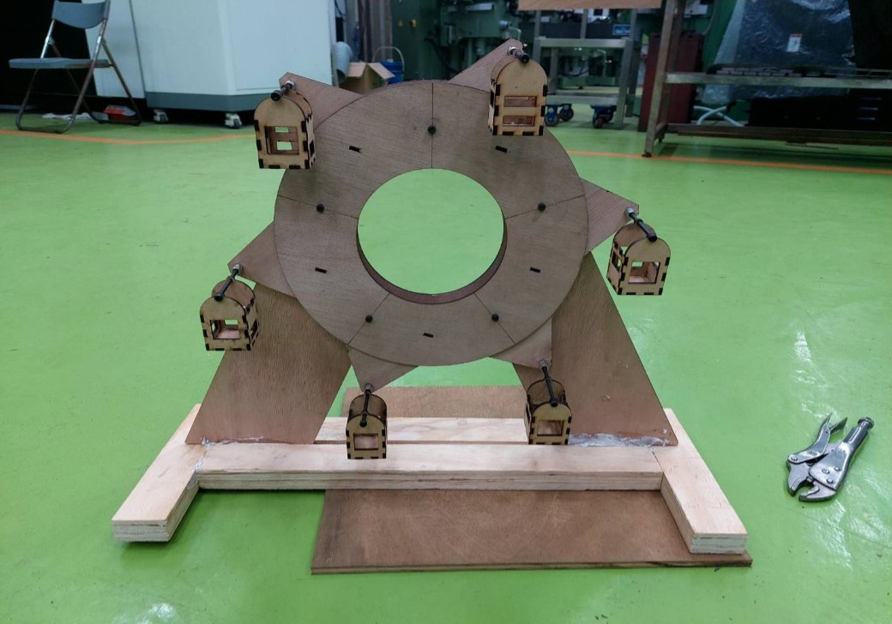
</p>

[中文說明](#中文說明)

## Overview

The team project was a **hubless Ferris wheel**: the wheel turns without a central axle, so the middle stays open. The team's report lists three features: **no axle, fully laser-cut, all wood**. Inside, small 7-tooth gears mesh with an internally toothed outer ring. In the report's reflection, the team says a planetary gear train was the idea that made the axle-free design possible.

In this three-person team I was responsible for the **mechanical drawings (機械畫圖)** and shared the design work. This repository contains:

- **Drawing sheets** for the Ferris-wheel parts and the assembly, made in AutoCAD with CNS-style frames and title blocks.
- **Rhino models and laser-cut layouts**: concept model, rings, gears, the A-frame stand, and several cabin designs.
- **DXF cutting files** for the cabins (finger-jointed plywood boxes with hanger tabs).
- Two **homework sheets** from the same course: surface texture and a hexagon-head bolt.

## Drawings

All sheets were plotted from AutoCAD. The student-ID field in each title block has been blanked out. On HW-4 the Dwg. # field, which read "Exam", has also been blanked.

| Sheet | Content | Scale | Date |
|---|---|---|---|
| [Ferris wheel, sheet 1](drawings/ferris-wheel-sheet1-gears.png) | (a) outer ring gear (外齒圈), R150, six mounting arms 20 mm wide and 100 mm long with Ø4 holes; (b) inner toothed ring (內尺圈), Ø150; (c) planet gear (行星齒輪), Ø4 bore. The callouts read t3×65, t3×33 and t3×7 (3 mm plate). | 1:5 | 2023-05-01 |
| [Ferris wheel, sheet 2](drawings/ferris-wheel-sheet2-stand-and-ring.png) | Support stand (R150 head, Ø145 opening, 300 mm from the base to the hub centre, 150 mm feet, 117° / 66° legs) and the Ø300 / Ø145 front cover ring, t3. See the note below. | 1:5 | 2023-05-01 |
| [Ferris wheel, assembly](drawings/ferris-wheel-assembly.png) | Assembly drawing: ring gears with the planet gears, six arms carrying drum cabins, and the A-frame stand. Taken from the team report. | 2:5 | 2023-05-01 |
| [HW-3](drawings/hw3-surface-texture.png) | Three views of a dovetail block (140 × 80 × 80) with surface-texture symbols (milled, Ra 1.6 / Ra 6.3) | 1:1 | 2023-05-24 |
| [HW-4](drawings/hw4-hex-bolt-m24x70.png) | Hexagon-head bolt in conventional representation (assignment spec M24, L70), front and right-side views | 1:1 | 2023-06-06 |

Sheet 2 is an earlier plot, and both of its view labels read "(a) 環形齒輪". In the final version in the team report, the views are labelled (d) 支撐架 (support stand) and (e) 外殼 (cover). The team report also contains a 1:1 cabin-parts sheet ((f) side frame, (g) hook, (i) front frame), which is not reproduced here.

<p align="center">
  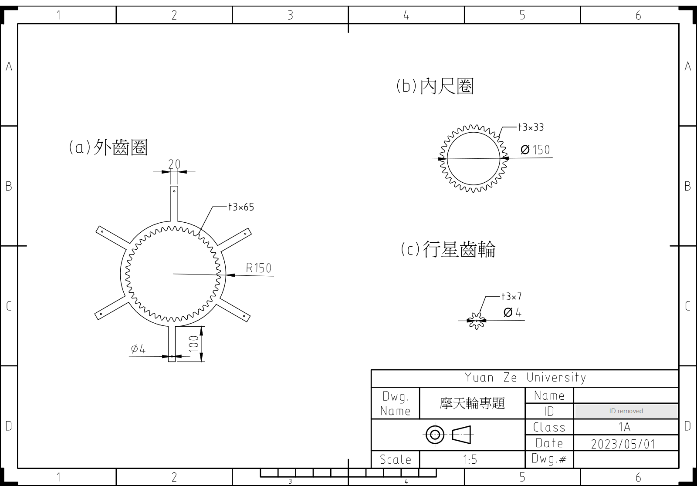
  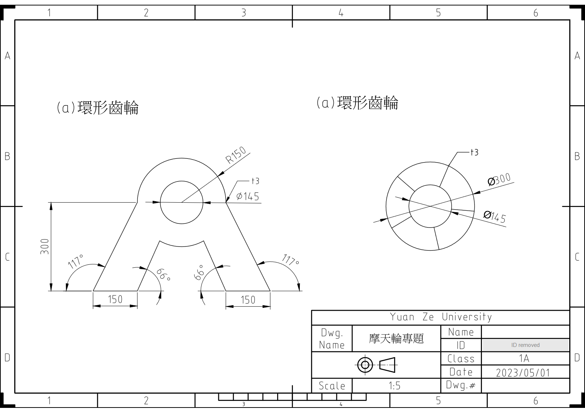
</p>
<p align="center">
  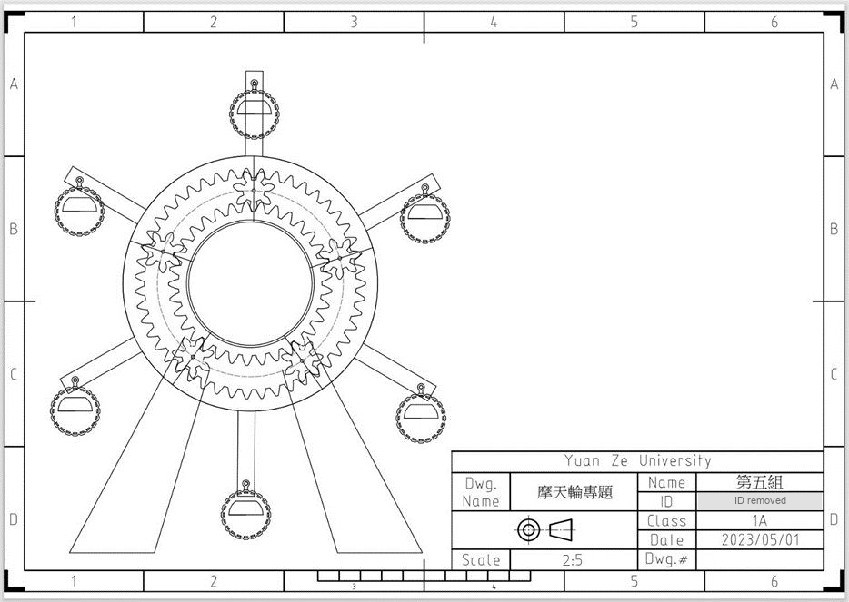
</p>
<p align="center">
  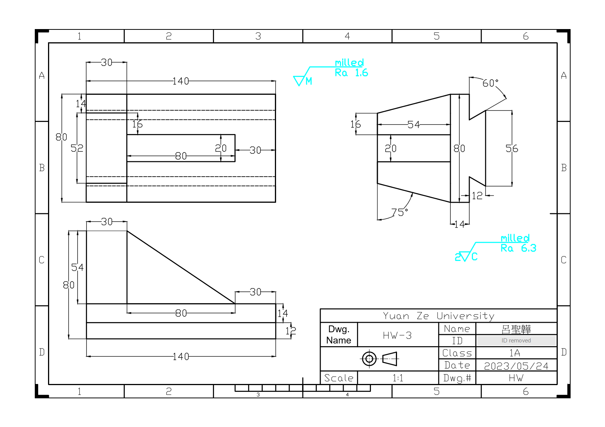
  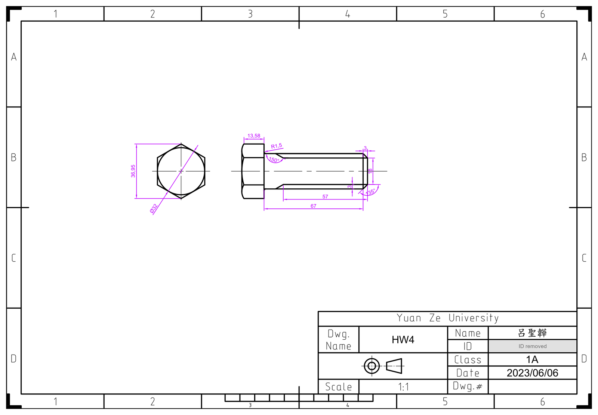
</p>

## CAD files

Drawings and DXF files are in millimetres. "Last saved" is the modification date of the original file.

| File | Content | Last saved |
|---|---|---|
| `cad/rhino/ferris-wheel-concept.3dm` | Early 3D concept: segmented ring with six cylindrical elements around the rim | 2023-04-26 |
| `cad/rhino/lasercut-rings.3dm` | First laser-cut layout: plain rings and two six-arm ring frames | 2023-04-26 |
| `cad/rhino/cabin-box-lasercut.3dm` | Finger-jointed cabin with a hanger loop, window slots, a door outline and an emblem-shaped cut-out | 2023-05-08 |
| `cad/rhino/gear-shaft-study.3dm` | 3D study of a 7-tooth gear on a shaft with a cylindrical body | 2023-05-09 |
| `cad/rhino/lasercut-gears-and-stand.3dm` | Laser-cut layout: toothed rings and gears, six-point star rings, segmented cover rings, A-frame stand halves | 2023-05-10 |
| `cad/dxf/cabin-pentagon-v1.dxf` | Pentagonal cabin with star cut-outs and a separate hanger tab (DXF R12) | 2023-05-29 |
| `cad/dxf/cabin-pentagon-v2.dxf` | Revised pentagonal cabin with the hanger tab joined to the end plates (DXF R12) | 2023-05-29 |
| `cad/dxf/cabin-drum.dxf` | Drum cabin: round end plates with half-moon windows, slats and hooks (DXF R12) | 2023-05-29 |
| `cad/rhino/cabin-rectangular-lasercut.3dm` / `cad/dxf/cabin-rectangular.dxf` | Rectangular cabin panels with windows and hanger tabs (Rhino source and DXF export) | 2023-06-01 |
| `cad/rhino/cabin-3d-model.3dm` | 3D model of a cabin | 2023-06-11 |

| Pentagonal cabin v1 | Pentagonal cabin v2 | Drum cabin |
|---|---|---|
| 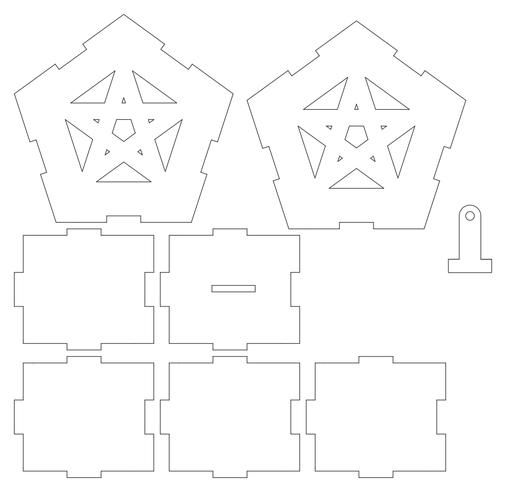 | 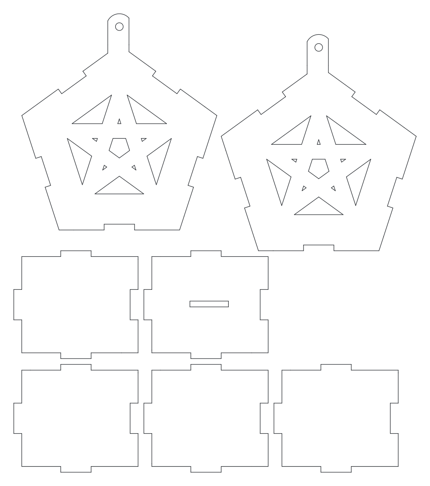 | 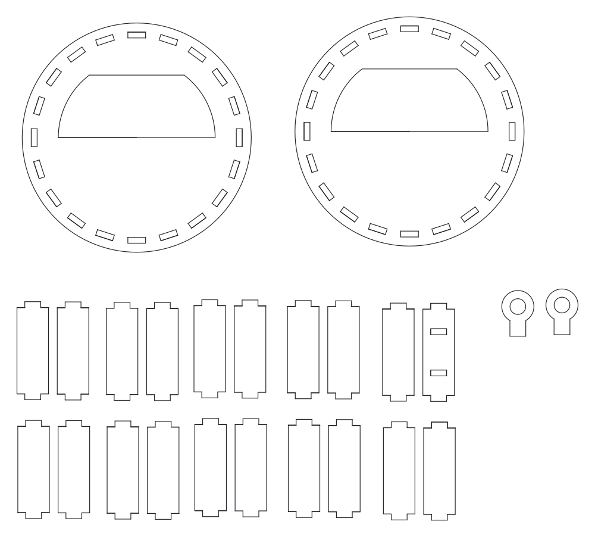 |

| Rectangular cabin | Cabin box | Laser-cut rings |
|---|---|---|
| 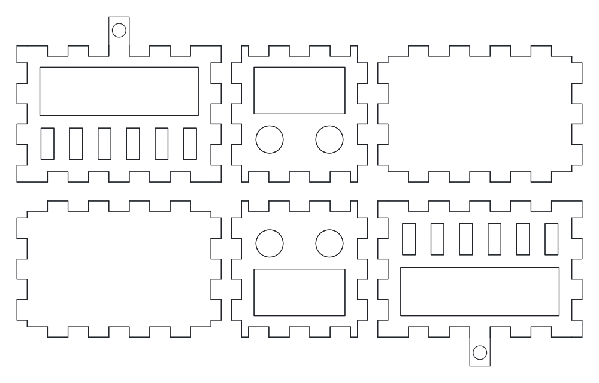 | 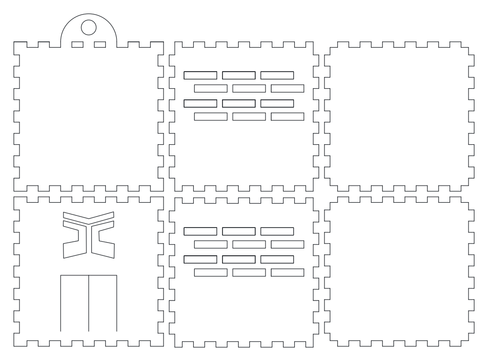 | 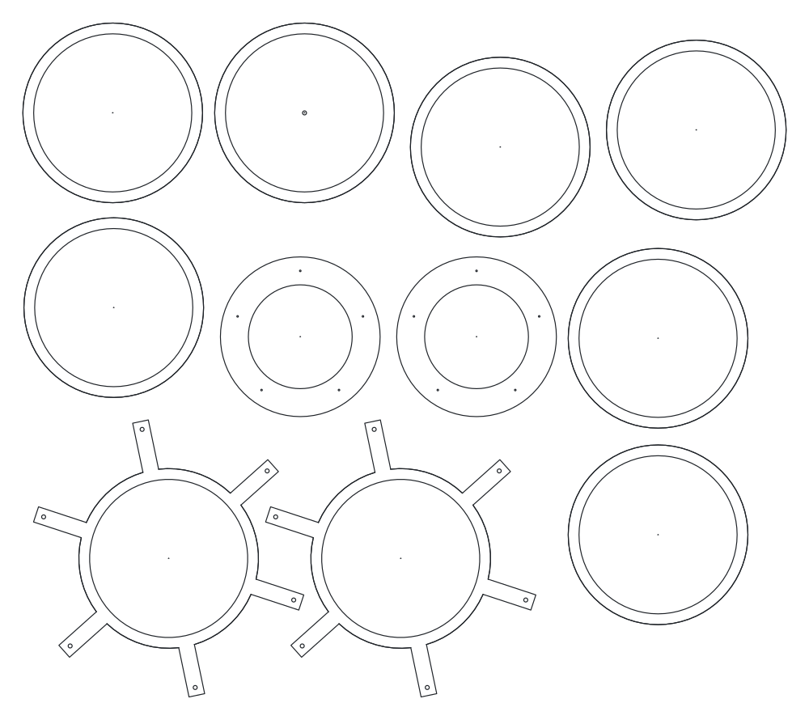 |

**Laser-cut gears and stand**

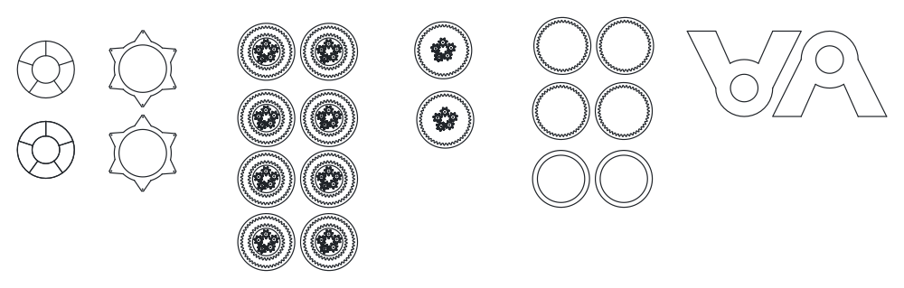

| Concept model | Gear and shaft study | Cabin 3D model |
|---|---|---|
| 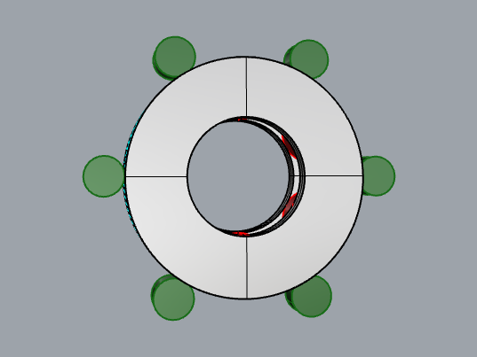 | 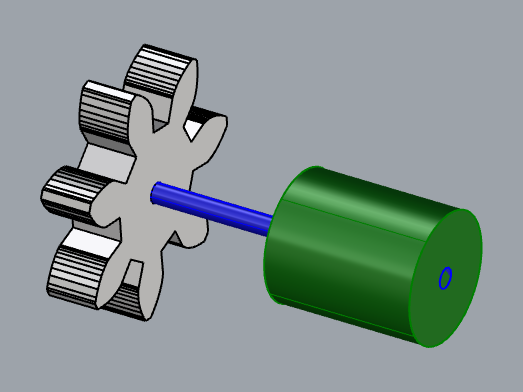 | 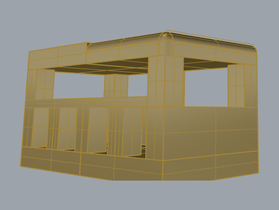 |

The SVG previews are line renders generated from the CAD geometry. The PNG thumbnails are the Rhino viewport previews stored inside each `.3dm` file, cropped to the model. They are shown as saved, so the cabin model is cut off at the bottom edge.

## Parts and weights

Measured masses from the team's report (Workshop Practice, 無軸式摩天輪):

| # | Part | 零件 | Mass (g) |
|---|---|---|---|
| 1 | Washer | 墊片 | 0.8 |
| 2 | Nut | 螺帽 | 1.1 |
| 3 | Rod, short | 桿子（短） | 4.2 |
| 4 | Rod, long | 桿子（長） | 7.9 |
| 5 | Gear | 齒輪 | 5.6 |
| 6 | Cabin | 車廂 | 17.2 |
| 7 | Front cover plate | 前封板 | 87.1 |
| 8 | Outer ring gear | 外齒圈 | 137.2 |
| 9 | Stand | 支架 | 578.5 |
| 10 | Assembly without cabins | 整體（不含車廂） | 877.2 |
| 11 | Assembly with cabins | 整體（含車廂） | 1027.8 |

The report groups items 1–4 as workshop parts (工廠零件) and items 5–11 as the Ferris-wheel structure (摩天輪構造).

### Load check (by teammate 楊承翰)

| Quantity | Value |
|---|---|
| Weight of one cabin on its rod (m = 17.2 g, g = 9.81 m/s²) | P₁ = 168.7 mN |
| Bending moment at the rod root | M = 624.3 mN·cm |
| Average stress where cabin, rod and nuts bear on the board (P = 289.4 mN, A₁ = 0.12 cm²) | σ_avg = 2411.7 mN/cm² |
| Maximum shear stress in the rod (V_max = 278.6 mN, A₂ = 0.1 cm²) | τ_max = 3714.7 mN/cm² |
| Total weight W: one cabin with rod and nuts (W₁ = P) + front plate, outer ring and gears (W₂) + stand (W₃) | W = 289.4 + 2932.2 + 5675.1 = 8896.7 mN |

<p align="center">
  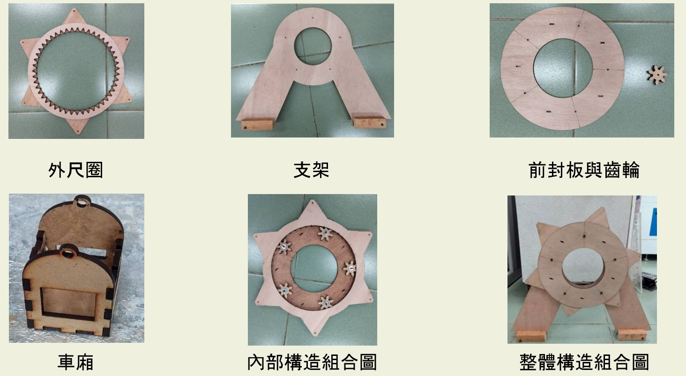
</p>

## Project structure

```
mechanical-drawing-ferris-wheel/
├── drawings/   plotted drawing sheets (PNG, student-ID field removed)
├── cad/
│   ├── rhino/  Rhinoceros 7 models and laser-cut layouts (.3dm)
│   └── dxf/    laser-cut cabin layouts (.dxf, mm)
├── previews/   SVG line renders and Rhino viewport thumbnails
├── photos/     photos of the finished model (from the team report)
├── LICENSE     CC BY 4.0 legal code
├── NOTICE.md   what the license covers and what it does not
└── README.md
```

## How to open the files

- **`.3dm`**: Rhinoceros 7 or later. Developers can also read the files with McNeel's open-source [rhino3dm](https://github.com/mcneel/rhino3dm) / openNURBS libraries. In `cabin-box-lasercut.3dm` and `lasercut-gears-and-stand.3dm` the render data (materials, environment and texture cache) has been removed before publishing. The geometry and layers are unchanged, and Rhino falls back to its default render settings.
- **`.dxf`**: Any DXF-capable CAD program (AutoCAD, LibreCAD, FreeCAD, DraftSight). The pentagon and drum cabins are DXF R12. The rectangular cabin is a DXF 2007 export from Rhino. For laser cutting, import at 1 unit = 1 mm and check the material thickness (3 mm plate on the drawings).
- **Drawings**: plain PNG images.

## Tools

AutoCAD 2024 (2D drafting and title blocks) · Rhinoceros 7 (3D modelling, laser-cut nesting) · DXF export for laser cutting · laser-cut plywood.

## Context

- Course: **Mechanical Drawing (機械畫)**, ME475, Yuan Ze University (元智大學). First year, second semester, spring 2023.
- The Ferris wheel (摩天輪專題) was built and presented in **Workshop Practice (工廠實習)** the same semester.
- Drawings follow the course standards: CNS frames and title blocks; line weights 0.5 mm (outlines), 0.35 mm (hidden lines) and 0.18 mm (text, dimensions, centre lines).

## Credits

Team project with **楊承翰** and **陳品羲**. Work split as listed in the team report:

| Role | Members |
|---|---|
| Design | 楊承翰, 呂聖韡, 陳品羲 |
| Mechanical analysis | 楊承翰 |
| Mechanical drawings (CAD) | 呂聖韡 (Sheng-Wei Lu) |
| Workshop fabrication and integration | 陳品羲 |

- The photos, the assembly drawing and the parts/weights table come from the team report. The load-check values are from 楊承翰's analysis.
- The gear tooth profiles (layers `sungear`, `planetgear`, `ringgear`) appear to come from an online planetary-gear generator. The finger-joint cabin panels (layers `*_outsideCutPath`) appear to start from a box-generator export that was then edited.

## License

My own drawings, CAD files, previews and documentation are licensed under [CC BY 4.0](LICENSE), © 2026 Sheng-Wei Lu (呂聖韡). The team's photos, the analysis figures and some third-party elements are **not** covered by this license; see [NOTICE.md](NOTICE.md).

---

## 中文說明

### 無軸式摩天輪：機械畫與雷射切割 CAD

本專案收錄一座無軸木製摩天輪的工程圖、Rhino 模型與雷射切割排版，並附上兩張工程圖作業。內容為元智大學「機械畫」課程作業（2023 年春季）。

### 專案概述

這是一個三人小組專題，題目為**無軸式摩天輪**：轉輪不靠中心軸轉動，中央保持鏤空。依小組報告，作品特色為**全無軸、全雷切、全木材**。內部是數個 7 齒小齒輪與內齒外圈互相嚙合；報告的心得提到，行星齒輪傳動模型是發想出無軸設計的關鍵。

我在小組中負責**機械畫圖**，並參與整體設計。本儲存庫包含：

- **摩天輪零件圖與組合圖**：以 AutoCAD 繪製，使用 CNS 圖框與標題欄。
- **Rhino 模型與雷切排版**：概念模型、圓環、齒輪、A 字支架與多款車廂。
- **車廂 DXF 雷切檔**：指接（finger joint）合板箱體，附吊掛耳片。
- 同課程的兩張**作業圖**：表面織構符號、六角頭螺栓。

### 工程圖

所有圖紙皆由 AutoCAD 出圖，標題欄中的學號欄位已遮蔽；HW-4 的 Dwg. # 欄原本寫著「Exam」，也一併清空。

| 圖紙 | 內容 | 比例 | 日期 |
|---|---|---|---|
| [摩天輪專題 第 1 張](drawings/ferris-wheel-sheet1-gears.png) | (a) 外齒圈：R150，六支安裝臂（寬 20、長 100，Ø4 孔）；(b) 內尺圈：Ø150；(c) 行星齒輪：Ø4 軸孔。圖上標註為 t3×65、t3×33、t3×7（板厚 3 mm）。 | 1:5 | 2023-05-01 |
| [摩天輪專題 第 2 張](drawings/ferris-wheel-sheet2-stand-and-ring.png) | 支架（頂部 R150、開孔 Ø145、底面至中心孔圓心 300、腳寬 150、角度 117°／66°）及 Ø300／Ø145 前封環，t3。請見下方說明。 | 1:5 | 2023-05-01 |
| [摩天輪專題 組合圖](drawings/ferris-wheel-assembly.png) | 組合圖：齒圈與行星齒輪、六支吊掛圓筒車廂的支臂，以及 A 字支架。取自小組報告。 | 2:5 | 2023-05-01 |
| [HW-3](drawings/hw3-surface-texture.png) | 鳩尾座三視圖（140 × 80 × 80），含表面織構符號（銑削，Ra 1.6／Ra 6.3） | 1:1 | 2023-05-24 |
| [HW-4](drawings/hw4-hex-bolt-m24x70.png) | 習用畫法六角頭螺栓（作業規格 M24、L70），前視圖與右側視圖 | 1:1 | 2023-06-06 |

第 2 張為較早的出圖版本，兩個視圖的標示都寫成「(a) 環形齒輪」；小組報告中的定稿已改為 (d) 支撐架 與 (e) 外殼。小組報告另有一張 1:1 的車廂零件圖（(f) 側面邊框、(g) 鉤子、(i) 正面邊框），本儲存庫未收錄。

### CAD 檔案

工程圖與 DXF 檔單位為公釐（mm）。「最後儲存」為原始檔案的修改日期。

| 檔案 | 內容 | 最後儲存 |
|---|---|---|
| `cad/rhino/ferris-wheel-concept.3dm` | 早期 3D 概念模型（分段圓環，外圍六個圓柱元件） | 2023-04-26 |
| `cad/rhino/lasercut-rings.3dm` | 第一版雷切排版：圓環與兩個六臂環架 | 2023-04-26 |
| `cad/rhino/cabin-box-lasercut.3dm` | 指接車廂：吊環、窗縫、門的輪廓與一個徽章形鏤空 | 2023-05-08 |
| `cad/rhino/gear-shaft-study.3dm` | 7 齒齒輪裝在軸上、連接圓柱體的 3D 研究 | 2023-05-09 |
| `cad/rhino/lasercut-gears-and-stand.3dm` | 雷切排版：齒環與齒輪、六角星環、分段封環、A 字支架 | 2023-05-10 |
| `cad/dxf/cabin-pentagon-v1.dxf` | 五角形車廂，星形鏤空，吊耳為獨立零件（DXF R12） | 2023-05-29 |
| `cad/dxf/cabin-pentagon-v2.dxf` | 五角形車廂修訂版，吊耳與端板合為一體（DXF R12） | 2023-05-29 |
| `cad/dxf/cabin-drum.dxf` | 圓筒車廂：半月窗圓形端板、板條與掛鉤（DXF R12） | 2023-05-29 |
| `cad/rhino/cabin-rectangular-lasercut.3dm`、`cad/dxf/cabin-rectangular.dxf` | 長方形車廂面板，含窗與吊耳（Rhino 原檔與 DXF 匯出） | 2023-06-01 |
| `cad/rhino/cabin-3d-model.3dm` | 車廂 3D 模型 | 2023-06-11 |

SVG 預覽圖是由 CAD 幾何產生的線稿；PNG 縮圖則是各 `.3dm` 檔內建的 Rhino 視窗預覽，已裁切到模型範圍，內容維持存檔時的樣子（因此車廂模型底部被切掉）。

### 零件與重量

以下數據取自小組報告（工廠實習「無軸式摩天輪」）。報告將第 1–4 項歸類為「工廠零件」，第 5–11 項為「摩天輪構造」：

| 編號 | 零件 | 重量（g） |
|---|---|---|
| 1 | 墊片 | 0.8 |
| 2 | 螺帽 | 1.1 |
| 3 | 桿子（短） | 4.2 |
| 4 | 桿子（長） | 7.9 |
| 5 | 齒輪 | 5.6 |
| 6 | 車廂 | 17.2 |
| 7 | 前封板 | 87.1 |
| 8 | 外齒圈 | 137.2 |
| 9 | 支架 | 578.5 |
| 10 | 整體（不含車廂） | 877.2 |
| 11 | 整體（含車廂） | 1027.8 |

**力學分析（由組員楊承翰完成）：** 單一車廂重力 P₁ = 168.7 mN，桿根彎矩 M = 624.3 mN·cm；車廂、桿子與螺帽作用於板上的平均應力 σ_avg = 2411.7 mN/cm²；桿子最大剪應力 τ_max = 3714.7 mN/cm²；整體總重 W = W₁（單一車廂加桿子加螺帽）+ W₂（前封板、外齒圈加齒輪）+ W₃（支架）= 289.4 + 2932.2 + 5675.1 = 8896.7 mN。

### 檔案結構

```
mechanical-drawing-ferris-wheel/
├── drawings/   出圖圖紙（PNG，學號欄已遮蔽）
├── cad/
│   ├── rhino/  Rhinoceros 7 模型與雷切排版（.3dm）
│   └── dxf/    車廂雷切檔（.dxf，單位 mm）
├── previews/   SVG 線稿預覽與 Rhino 視窗縮圖
├── photos/     成品照片（取自小組報告）
├── LICENSE     CC BY 4.0 授權條款全文
├── NOTICE.md   授權範圍與不適用的內容
└── README.md
```

### 開啟方式

- **`.3dm`**：Rhinoceros 7 以上版本；開發者也可使用 McNeel 開源的 [rhino3dm](https://github.com/mcneel/rhino3dm)／openNURBS 函式庫讀取。`cabin-box-lasercut.3dm` 與 `lasercut-gears-and-stand.3dm` 在發布前已移除算圖資料（材質、環境與貼圖快取），幾何與圖層不變，Rhino 會改用預設算圖設定。
- **`.dxf`**：任何支援 DXF 的 CAD 軟體（AutoCAD、LibreCAD、FreeCAD、DraftSight）。五角形與圓筒車廂為 DXF R12；長方形車廂為 Rhino 匯出的 DXF 2007。雷切時請以 1 單位 = 1 mm 匯入，並確認板厚（圖面標註為 3 mm）。
- **工程圖**：一般 PNG 圖片。

### 使用工具

AutoCAD 2024（2D 製圖、標題欄）· Rhinoceros 7（3D 建模、雷切排版）· DXF 匯出供雷射切割 · 合板雷射切割。

### 課程背景

- 課程：**機械畫（Mechanical Drawing，ME475）**，元智大學，大一下學期（2023 年春季）。
- 摩天輪專題於同學期的**工廠實習**課程中製作並發表。
- 圖面依課程規範繪製：CNS 圖框與標題欄；線寬 0.5 mm（外形線）、0.35 mm（隱藏線）、0.18 mm（文字、尺寸、中心線）。

### 致謝

本專題由**楊承翰**、**陳品羲**與我共同完成，分工如下（依小組報告）：設計：楊承翰、呂聖韡、陳品羲；力學分析：楊承翰；機械畫圖：呂聖韡；工廠實習與統整：陳品羲。成品照片、組合圖與零件重量表取自小組報告，力學分析數據由楊承翰完成。

齒輪齒形（圖層 `sungear`、`planetgear`、`ringgear`）看起來來自線上行星齒輪產生器；指接車廂面板（圖層 `*_outsideCutPath`）看起來是以箱體產生器的匯出檔為基礎再修改。

### 授權

我本人繪製的工程圖、CAD 檔、預覽圖與文件採用 [CC BY 4.0](LICENSE) 授權，© 2026 Sheng-Wei Lu（呂聖韡）。小組的照片、力學分析數據與部分第三方元素**不**在此授權範圍內，詳見 [NOTICE.md](NOTICE.md)。
